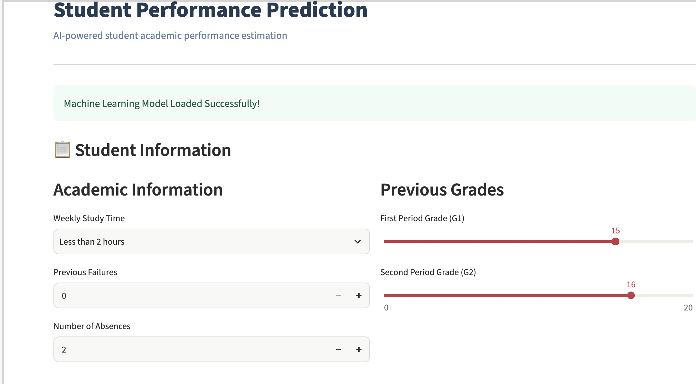
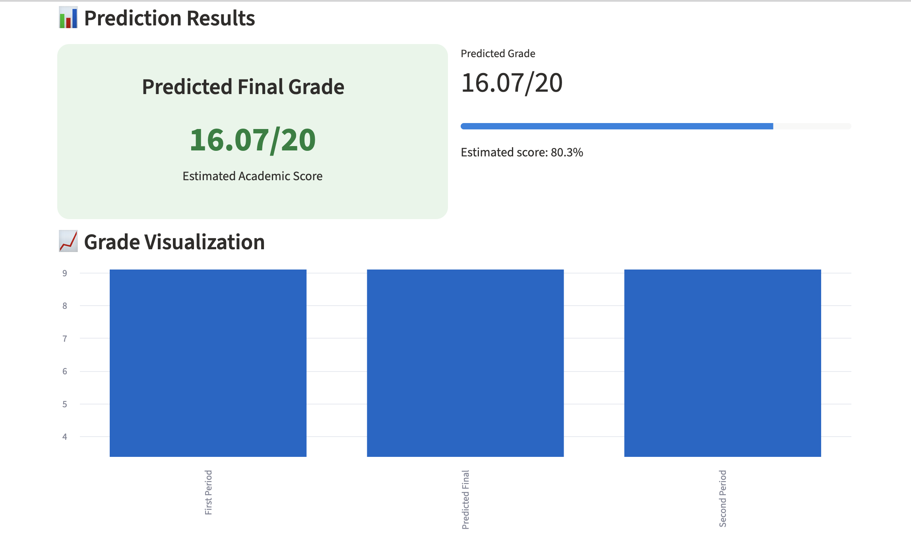
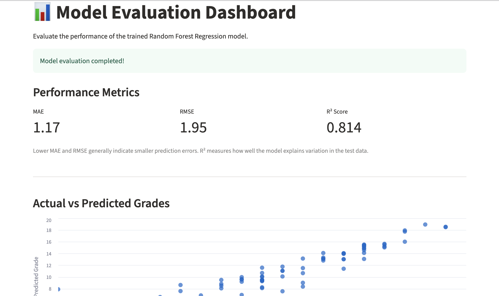

# 🎓 Student Performance Prediction

## 📌 Project Overview

Student Performance Prediction is an End-to-End Machine Learning project that predicts students' final academic grades using the Random Forest Regression algorithm.

The project includes data preprocessing, feature engineering, model training, evaluation, model saving, and an interactive Streamlit web application.

## 🚀 Features

- Student performance prediction
- Data preprocessing
- Feature engineering
- Random Forest Regression
- Model evaluation
- MAE, RMSE and R2 metrics
- Actual vs Predicted visualization
- Feature importance visualization
- Interactive Streamlit dashboard
- Saved ML model using Joblib

## 🛠 Technologies Used

- Python
- Pandas
- NumPy
- Scikit-learn
- Matplotlib
- Streamlit
- Joblib

## 📂 Project Structure

```text
StudentMLProject/
│
├── data/
│   └── student-mat.csv
│
├── models/
│   └── student_model.pkl
│
├── main.py
├── app.py
├── test_saved_model.py
├── requirements.txt
├── README.md
└── .gitignore
```

## ⚙️ Installation

### 1. Clone the repository

```bash
git clone YOUR_GITHUB_REPOSITORY_URL
```

### 2. Open the project folder

```bash
cd StudentMLProject
```

### 3. Create virtual environment

```bash
python3 -m venv .venv
```

### 4. Activate environment

```bash
source .venv/bin/activate
```

### 5. Install dependencies

```bash
pip install -r requirements.txt
```

### 6. Download dataset

Download the Student Performance dataset from:

https://archive.ics.uci.edu/dataset/320/student+performance

Place student-mat.csv inside the data folder.

## ▶️ Run the Project

### Train the Machine Learning Model

```bash
python main.py
```

### Test the Saved Model

```bash
python test_saved_model.py
```

### Launch the Streamlit Application

```bash
streamlit run app.py
```

Open http://localhost:8501 in your browser.

## 🤖 Machine Learning Algorithm

Random Forest Regression is used to predict the final student grade.

### Input Features

- Study Time
- Previous Failures
- Absences
- First Period Grade (G1)
- Second Period Grade (G2)
- School Support
- Family Support
- Internet Access

### Target Variable

G3 - Final Student Grade

## 📊 Model Evaluation

The model is evaluated using:

- Mean Absolute Error (MAE)
- Root Mean Squared Error (RMSE)
- R2 Score

## 📚 Dataset

Source: UCI Machine Learning Repository

Student Performance Dataset.

## 👨‍💻 Author

Satrik Mondal

## 📄 License

This project is intended for educational purposes.

## 🖥️ Application Screenshots

### Dashboard



### Student Performance Prediction



### Model Evaluation


